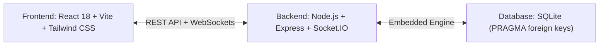

# 🏏 Village Cricket Live - Scoring & Tournament Platform

A modern full-stack web application built for village cricket tournaments, gully cricket championships, and local premier leagues. Designed to provide **real-time live ball-by-ball score updates for spectators** and a **live scoring console for scorers / developers** on the ground.

---

## 🌟 Key Features

### 1. 🔴 Live Match Viewer ("Village Tournament Live Score Chudali")
- **Real-Time Ball-by-Ball Sync**: Powered by **WebSockets (Socket.IO)** — whenever the scorer records a run or wicket, every spectator's screen updates immediately without page reloads.
- **Over Timeline & Badges**: Circle badges for every delivery (`0`, `1`, `4`, `6`, `W`, `Wd`, `Nb`).
- **Active Batsmen & Bowler**: Real-time runs, balls faced, 4s, 6s, strike rate, bowler spell overs, maidens, runs conceded, wickets, and economy rate.
- **Ball-by-Ball Commentary Feed**: Automated descriptive match commentary for boundaries, wickets, and milestones.
- **Full Match Scorecard**: Comprehensive batting cards, fall of wickets, extras breakdown, and complete bowling analysis.
- **Run Rate & Equation Tracker**: Current Run Rate (CRR), Required Run Rate (RRR), Target, and balls remaining.

### 2. 📝 Scorer Console ("Developer / Scorer Score Enter Cheyali")
- **Fast Runs Keypad**: Instant one-tap scoring for `0 (Dot)`, `1`, `2`, `3`, `4 (Four)`, `6 (Six)`.
- **Extras Controls**: `Wide (Wd)`, `No Ball (Nb)`, `Leg Bye (Lb)`, `Bye (B)` with penalty calculations.
- **Wicket Modal**: Bowled, Caught, Run Out, Stumped, LBW, Hit Wicket with fielder selection and incoming batsman selector.
- **Over Management**: Auto-prompts for next bowler at 6 legal balls; bowler cannot bowl consecutive overs.
- **Strike Rotation**: Auto strike rotation on odd runs (1, 3) and at over completion.
- **⇄ Strike Swapper**: Manual striker/non-striker swap button.
- **↺ Undo Delivery**: Easily revert any mistake delivery to fix misclicks on the ground.
- **Innings & Match Transition**: End 1st innings with auto target generation, start 2nd innings lineup, and automatic winner declaration.

### 3. 👥 Player Statistics & Leaderboards ("Stores Players Data")
- **Orange Cap Leaderboard**: Top tournament run-scorers ranked by runs and strike rate.
- **Purple Cap Leaderboard**: Top wicket-takers ranked by wickets and economy rate.
- **Career Breakdown Modal**: Total matches, innings, runs, high score, strike rate, overs bowled, wickets, and recent match log.
- **Player Search**: Instant search by player name or village.

### 4. 🏆 Tournament & Standings
- Multi-tournament support (e.g., Sankranti Premier League, Gully Champions Cup).
- Automated Points Table (Played, Won, Lost, Tied, Points).
- Match scheduling and ground/venue tracking.

### 5. 🔐 Authentication & Roles
- **JWT Authentication** with password hashing (`bcryptjs`).
- **Roles**:
  - `SCORER` / `ADMIN`: Can conduct toss, select lineups, enter live scores, register players, create matches.
  - `VIEWER`: Can view live matches, scorecards, and player leaderboards.
- **One-Click Demo Credentials**:
  - Scorer: `scorer@village.com` / `admin123`
  - Admin: `admin@village.com` / `admin123`
  - Viewer: `viewer@village.com` / `admin123`

---

## 🏗️ Architecture & Tech Stack



- **Frontend**: React 18, Vite, Tailwind CSS, Lucide React, Socket.IO Client, React Router v6
- **Backend**: Node.js, Express, Socket.IO, JSON Web Tokens (JWT), Bcrypt.js
- **Database**: SQLite (Node built-in `node:sqlite` zero-dependency engine)

---

## 🚀 Quick Start Guide

### Prerequisites
- Node.js (v18+) and npm

### 1. Installation
Clone repository and install dependencies:
```bash
# Install backend dependencies
cd server
npm install

# Install frontend dependencies
cd ../client
npm install
```

### 2. Seed Database
Initialize the database with village teams, players, tournaments, and a live match:
```bash
cd ..
npm run seed
```

### 3. Run the Application
Start the full-stack app:
```bash
# Start backend server (Port 5000)
npm run start
```
Open your browser and navigate to:
```
http://localhost:5000
```

> **For Development with Vite Hot Reload:**
> Run `npm run server` in one terminal and `npm run client` in another terminal. Client runs on `http://localhost:3000` with proxy to port 5000.

---

## 📡 API Endpoints Summary

| Method | Endpoint | Description | Auth Required |
|---|---|---|---|
| POST | `/api/auth/register` | Register new user | No |
| POST | `/api/auth/login` | Login user & receive JWT | No |
| GET | `/api/auth/me` | Fetch logged-in user profile | Yes |
| GET | `/api/matches` | List matches (filter by LIVE, etc.) | No |
| GET | `/api/matches/:id` | Full live state & scorecard | No |
| POST | `/api/matches` | Create match | Scorer/Admin |
| POST | `/api/matches/:id/toss` | Record coin toss | Scorer/Admin |
| POST | `/api/matches/:id/start` | Start match with openers | Scorer/Admin |
| POST | `/api/matches/:id/score-ball` | Record delivery (runs/extras/wicket) | Scorer/Admin |
| POST | `/api/matches/:id/undo` | Undo last ball | Scorer/Admin |
| POST | `/api/matches/:id/change-bowler`| Update active bowler | Scorer/Admin |
| POST | `/api/matches/:id/change-batsman`| Update active batsman | Scorer/Admin |
| POST | `/api/matches/:id/swap-strike` | Swap striker & non-striker | Scorer/Admin |
| GET | `/api/players` | Search players & stats | No |
| GET | `/api/players/leaderboard` | Orange & Purple cap data | No |
| GET | `/api/tournaments` | List tournaments | No |
| GET | `/api/tournaments/:id` | Standings & points table | No |
